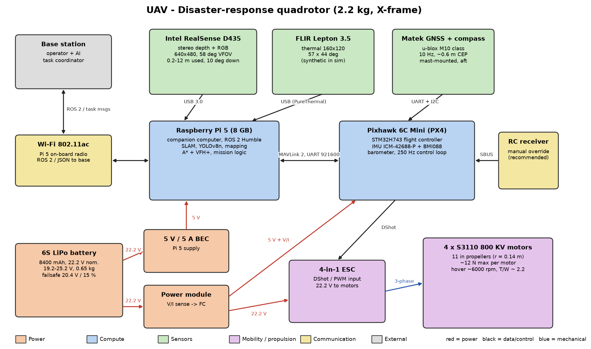
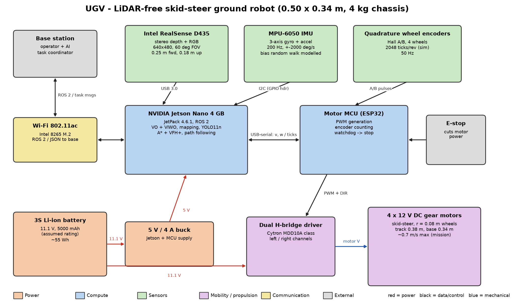

# Practical 1 – Platform and Sensor Familiarisation

**Module:** Collaborative Unmanned Ground and Aerial Systems
**Platforms:** Disaster-response UAV (quadrotor) and LiDAR-free UGV (skid-steer ground robot)

## 1. Aim

The aim is to inspect the UAV and UGV used in the collaborative inspection experiments and to identify, for each platform:

- the compute unit;
- the power source;
- the mobility or propulsion system;
- the sensors;
- the communication interfaces.

Each platform is summarised as a block diagram, and two capabilities and two limitations are recorded for each.

## 2. Sources Inspected

| Platform | Simulator model and specification files |
|---|---|
| UAV | `urdf/disaster_uav.urdf` (generated from `config/drone.yaml`), simulated flight controller `sim/flight_controller_sim.py`, sensor models `sim/sensors.py`, `sim/rgbd_camera.py`, `sim/thermal_camera.py`, MAVLink link `sim/mavlink_fc_server.py`, `companion/mavlink_client.py` |
| UGV | `robot_vision/robot_vision/simulation/simple_robot.urdf`, sensor models `simulation/viwo_sensors.py` (IMU, wheel encoders), camera set-up `simulation/stage1_simulation.py`, estimator `simulation/viwo_estimator.py` |

Values in `drone.yaml` tagged *[DATASHEET]* come from the hardware notes supplied with the project. Values tagged *[PLACEHOLDER]* are engineering assumptions. The UGV project defines the robot geometry and sensor models but does not name its compute board, motors or battery. For those items, a typical real component that matches the simulated interface is listed and marked **(assumed)**.

## 3. UAV – Disaster-Response Quadrotor

### 3.1 Specification

| Subsystem | Component (real hardware) | Key data (from the simulator model) |
|---|---|---|
| Airframe | Custom carbon-fibre X quadrotor | 2.2 kg all-up mass; 0.30 m arm length (0.60 m motor-to-motor diagonal); skid landing gear; inertia Ixx 0.0297, Iyy 0.0366, Izz 0.0553 kg·m² |
| **Main compute** | **Raspberry Pi 5, 8 GB** (companion computer) | Runs ROS 2 Humble: RGB-D SLAM (ORB-SLAM3 / visual-odometry fallback), YOLOv8n person detection (ONNX Runtime), 3-D voxel and semantic mapping, A\* + VFH+ planning, mission and failsafe logic. Output is velocity setpoints to the FC. |
| **Flight controller** | **Pixhawk 6C Mini** (STM32H743, PX4) | Attitude and rate control at 250 Hz, motor mixing, setpoint watchdog (0.5 s → hold), battery failsafe (land), arming checks |
| **Power source** | **6S LiPo, 8400 mAh** | 22.2 V nominal (19.2–25.2 V), ≈186 Wh, 0.65 kg; low-voltage warning at 21.0 V; failsafe at 20.4 V or 15 % state of charge. Power module feeds the FC and senses voltage and current; a 5 V / 5 A BEC supplies the Pi 5; avionics load ≈ 12 W. |
| **Propulsion** | 4 × Surpass Hobby **S3110 800 KV** brushless motors, **4-in-1 ESC**, 11-inch propellers | ≈ 12 N maximum thrust per motor (≈ 48 N total, thrust-to-weight ≈ 2.2); hover ≈ 6000 rpm (5.4 N per motor); motor and ESC lag τ = 45 ms; limits 5 m/s horizontal, 2 m/s climb, 35° tilt |
| **Sensors** | **Intel RealSense D435** stereo depth camera | RGB + aligned depth, 640 × 480, 58° vertical FOV; 0.2–12 m used range; depth noise σ = 0.001·z² m; pitched 10° down, 0.19 m ahead of the CG |
| | **FLIR Lepton 3.5** thermal camera | 160 × 120 radiometric, 57° × 44° FOV, NETD 0.05 °C. *Synthetic* in simulation (per-object temperature table). |
| | **IMU ICM-42688-P + BMI088** (inside Pixhawk 6C Mini) | 250 Hz; ±2000 °/s, ±16 g; gyro noise 5×10⁻⁵ rad/s/√Hz; bias random walk modelled |
| | **Matek GNSS module** (u-blox M10 class) with compass | 10 Hz; σ ≈ 0.6 m horizontal and 1.0 m vertical; 16 satellites, HDOP 0.7; healthy / degraded / denied modes; mast-mounted 0.22 m above the CG |
| | Barometer (inside Pixhawk) | Altitude hold aid; not used by the autonomy stack |
| **Communication** | Pi 5 ↔ Pixhawk: **MAVLink 2 over UART** (TELEM port, 921 600 baud) | Simulation uses the same MAVLink messages over UDP 14540: `SET_POSITION_TARGET_LOCAL_NED`, `COMMAND_LONG` (arm, mode, land), `HEARTBEAT`, `LOCAL_POSITION_NED`, `ATTITUDE`, `HIGHRES_IMU`, `GPS_RAW_INT`, `SYS_STATUS` |
| | Pi 5 ↔ base station: **Wi-Fi 802.11ac** (on-board radio) | ROS 2 topics and JSON task/status messages (registration, task assignment, progress, completion) |
| | Camera interfaces | D435 over USB 3.0; Lepton over USB (PureThermal board) |
| | RC receiver (SBUS) → Pixhawk | Manual override for safety pilot (recommended; not modelled in simulation) |

### 3.2 Block Diagram

### 3.3 Capabilities

1. **Wide-area and elevated observation.** From 5 m altitude the forward-pitched D435 and the Lepton cover a 6–11 m band ahead of the vehicle. The UAV can survey the whole 40 m × 30 m site in about one minute and can inspect structures that are out of reach from the ground. In Practical 3 it found all four inspection points, with localisation errors of 0.06–0.98 m, and inspected the 5 m tower from a 3.5 m standoff.
2. **Safe autonomous flight through a standard autopilot interface.** All motion goes through MAVLink to a PX4-class flight controller. That controller keeps its own safety layer: setpoint-loss hold, battery failsafe landing, arming checks and RC override. GNSS geo-tags every detection, and onboard SLAM and A\* + VFH+ allow navigation without a prior map.

### 3.4 Limitations

1. **Limited endurance and payload.** Hover needs about 300 W of electrical power (placeholder propulsion model: ≈ 205 W shaft power at 70 % efficiency, plus 12 W avionics). Usable battery energy is about 158 Wh (down to 15 % state of charge), which gives an upper bound of about 30 minutes. Wind, manoeuvring and battery ageing reduce this in practice. The UAV cannot loiter at a site for long sampling tasks or carry heavy sensors.
2. **Short-range, vision-dependent perception.** There is no LiDAR. Depth from the D435 stereo pair is reliable only to about 10 m, and its error grows with the square of range. RGB-D SLAM degrades with fast yaw, low texture or poor light. On Windows, where only the visual-odometry fallback runs, drift reached 3.9 m ATE in the dynamic scene. The UAV also cannot touch or closely inspect ground equipment without risking a collision.

## 4. UGV – LiDAR-Free Skid-Steer Ground Robot

### 4.1 Specification

| Subsystem | Component (real hardware) | Key data (from the simulator model) |
|---|---|---|
| Chassis | 4-wheel skid-steer platform | Body 0.50 × 0.34 × 0.12 m, 4.0 kg; wheel radius 0.08 m, width 0.04 m; track 0.38 m; wheelbase 0.34 m |
| **Main compute** | **NVIDIA Jetson Nano 4 GB** (JetPack 4.6.1) *(assumed)* | Runs the robot_vision stack: RGB-D visual odometry, VIWO fusion (visual + IMU + wheel), metric occupancy map, semantic landmark map (YOLO11n), topological map, A\* global planner, VFH+ local avoidance, lane/pavement constraints, swept-footprint safety check, differential-drive controller |
| Low-level controller | **ESP32 / Arduino-class MCU** *(assumed)* | Generates motor PWM, counts encoder ticks, applies a command watchdog (stop on timeout) |
| **Power source** | **3S Li-ion pack, 11.1 V, 5000 mAh (≈ 55 Wh)** *(assumed)* | Feeds the motor driver directly; a 5 V / 4 A buck converter supplies the Jetson and MCU; E-stop cuts motor power |
| **Mobility** | 4 × **12 V DC geared motors** with Hall encoders, **dual H-bridge driver** (Cytron MDD10A class) *(assumed parts)* | Skid-steer differential drive: left pair and right pair driven together; v = r(ωL+ωR)/2, ω = r(ωR−ωL)/track; 0.7 m/s mission speed limit |
| **Sensors** | **Intel RealSense D435** stereo depth camera | RGB + depth, 640 × 480, 60° FOV, 0.05–20 m simulated range; mounted 0.25 m forward and 0.18 m above the base centre |
| | **MPU-6050** 6-axis IMU | 3-axis gyro + 3-axis accelerometer at 200 Hz; gyro noise 0.0035 rad/s/√Hz, accel noise 0.035 m/s²/√Hz; initial gyro bias 0.004 rad/s with random walk 2.5×10⁻⁴ rad/s/√s |
| | **Quadrature wheel encoders** (one per motor) | 2048 ticks per revolution, 50 Hz, quantised with angle noise 0.0015 rad. Wheel slip appears naturally, as on a real robot. |
| | *Not fitted* | No LiDAR (LiDAR-free by design), no GNSS |
| **Communication** | **Wi-Fi 802.11ac** (Intel 8265 M.2 card) to base station | ROS 2 topics and JSON task/status messages; heartbeat-based link monitoring (3 s timeout → stop and hold) |
| | On-board buses | D435 over USB 3.0; MPU-6050 over I²C (Jetson 40-pin header); Jetson ↔ MCU over USB-serial (velocity commands down, encoder ticks up) |

### 4.2 Block Diagram

### 4.3 Capabilities

1. **Close-range, long-dwell ground inspection.** The UGV can stop next to equipment, face it at 1.6 m and collect images or sensor samples for as long as needed, at a fraction of the UAV's power (tens of watts, not about 300 W). In Practical 3 it inspected the equipment cabinet, the monitoring station and the unexplored region. Its own camera re-measured each target to within 0.21–0.78 m of the UAV's estimate.
2. **LiDAR-free autonomous navigation in cluttered space.** Fusing stereo depth, the MPU-6050 and wheel encoders (VIWO) gives localisation without GNSS. The occupancy, semantic and topological maps, A\* planning, VFH+ avoidance and swept-footprint checks let it pass obstacles and narrow openings, such as the 2 m passage into the unexplored region.

### 4.4 Limitations

1. **Restricted terrain and wheel slip.** The 0.08 m wheels and low chassis cannot climb steps, kerbs or debris much higher than about 5 cm. Skid-steering slips sideways whenever it turns. If the robot is blocked while its wheels keep turning, encoder odometry keeps counting motion: in the first Practical 3 run this produced up to 13 m of drift until slip detection was added.
2. **Low, narrow viewpoint and no global position.** The camera sits about 0.3 m above the ground with a 60° field of view. Obstacles easily hide what lies behind them, and the robot cannot see elevated structures. With no GNSS and no LiDAR, localisation relies on visual texture and odometry, which drift over long distances or on featureless ground. The UGV therefore depends on the UAV or base station for wide-area context.

## 5. Sensor Summary

| Sensor | Platform | Measures | Interface | Rate (sim) | Used for |
|---|---|---|---|---|---|
| Intel RealSense D435 | UAV, UGV | RGB image + metric depth | USB 3.0 | 5 Hz UAV / per control frame UGV | SLAM / VO, obstacle mapping, target detection and 3-D localisation |
| FLIR Lepton 3.5 | UAV | Surface temperature (°C) | USB (PureThermal) | 5 Hz | Survivor / hot-spot confirmation (synthetic in sim) |
| ICM-42688-P + BMI088 | UAV (in Pixhawk) | Angular rate, specific force | SPI (internal) | 250 Hz | FC attitude estimation, SLAM IMU input |
| u-blox M10 GNSS + compass | UAV | Latitude, longitude, altitude, heading | UART + I²C | 10 Hz | Geo-tagging, FC position aiding |
| MPU-6050 | UGV | Angular rate, specific force | I²C | 200 Hz | Heading propagation, VIWO fusion, gyro-bias calibration at standstill |
| Hall quadrature encoders | UGV | Wheel rotation | MCU GPIO (A/B) | 50 Hz | Wheel odometry, slip detection |
| Battery voltage / current | UAV (power module), UGV (MCU ADC) | V, I, state of charge | Analog / I²C | 2 Hz telemetry | Failsafe, availability check in task allocation |

## 6. Comparison and Relevance to Collaboration

| Aspect | UAV | UGV |
|---|---|---|
| Viewpoint | Elevated, wide-area | Ground level, close range |
| Endurance | ~20–30 min | Several hours at low speed (assumed 55 Wh pack, ~15–25 W average) |
| Localisation | GNSS + IMU (FC EKF) + RGB-D SLAM | VIWO (stereo VO + MPU-6050 + encoders), no GNSS |
| Obstacle handling | Fly over or around; A\* + VFH+ in the air | A\* + VFH+ on ground occupancy grid; limited by terrain |
| Best tasks | Survey, elevated inspection, target detection | Close-up inspection, sensor sampling, mapping of tight spaces |

These capabilities and limitations complement each other. They are the basis for the Practical 3 allocation: the UAV takes the aerial survey and elevated inspection, and the UGV takes close-range ground inspection and environmental sampling. A shared ENU frame at the base station lets the two platforms exchange target coordinates.

## 7. Notes on Simulation Versus Hardware

- Both platforms are simulated in PyBullet with physics-based dynamics. The UAV uses rotor forces, motor lag, battery sag and a simulated PX4-style FC; the UGV uses wheel–ground contact.
- Sensor models add realistic noise, bias and quantisation. Neither autonomy stack reads simulator ground truth.
- The UAV thermal camera output is synthetic: PyBullet has no radiometry.
- UGV compute, motor, driver and battery parts are not specified in the project and are listed as typical equivalents. Simulated sensor values come from `viwo_sensors.py` and `stage1_simulation.py`.
- Propulsion and endurance figures for the UAV use *[PLACEHOLDER]* coefficients and should be replaced with bench measurements (thrust stand, battery discharge test) before flight.
