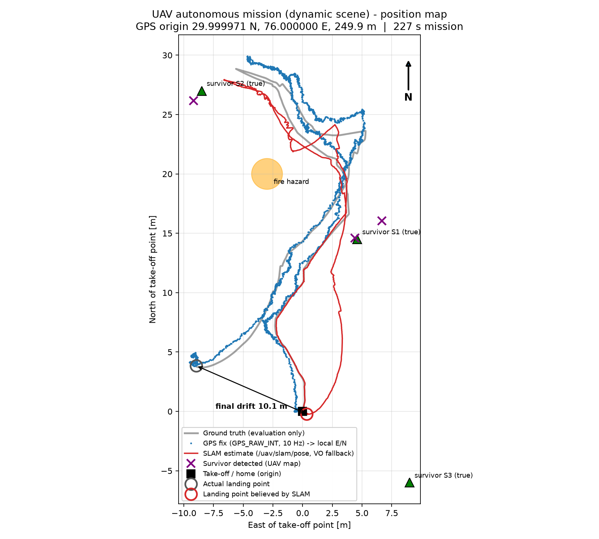
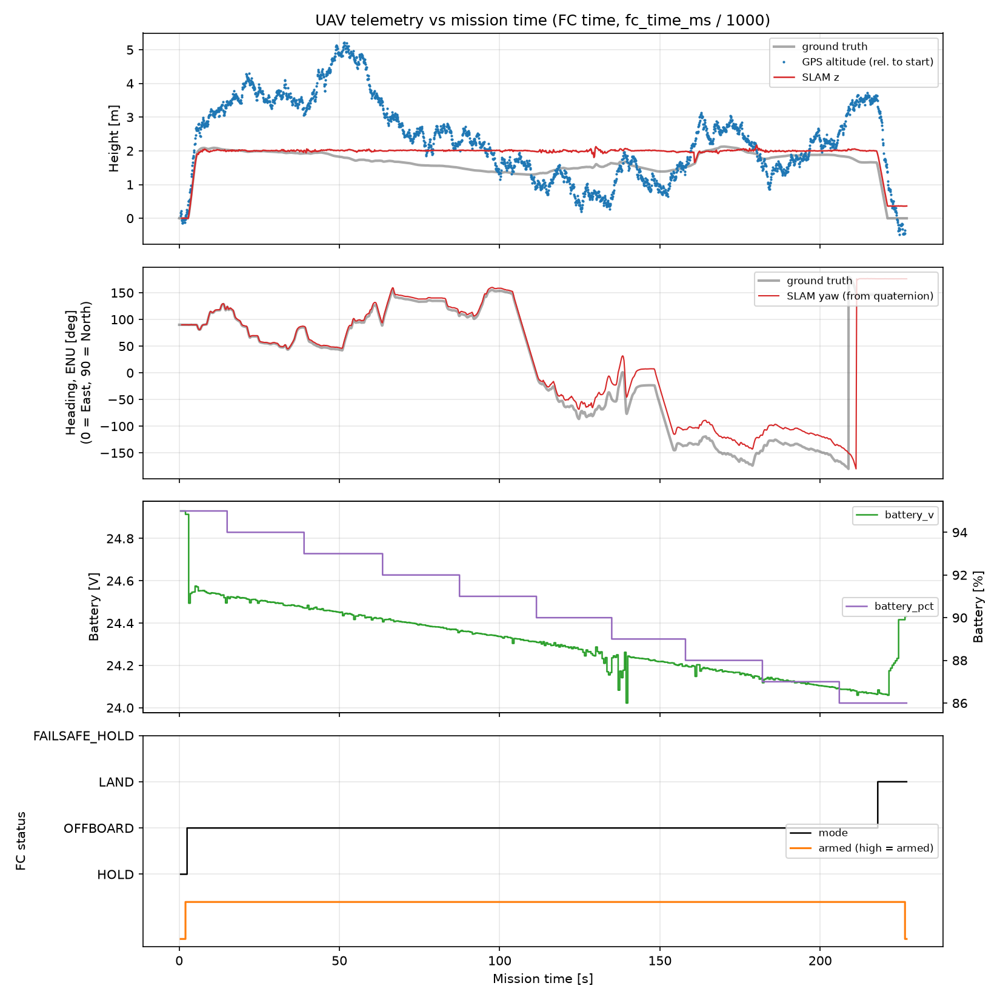
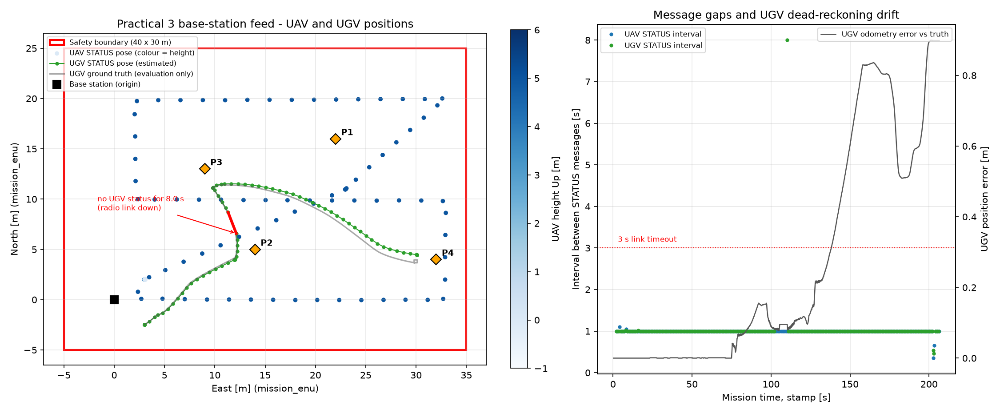
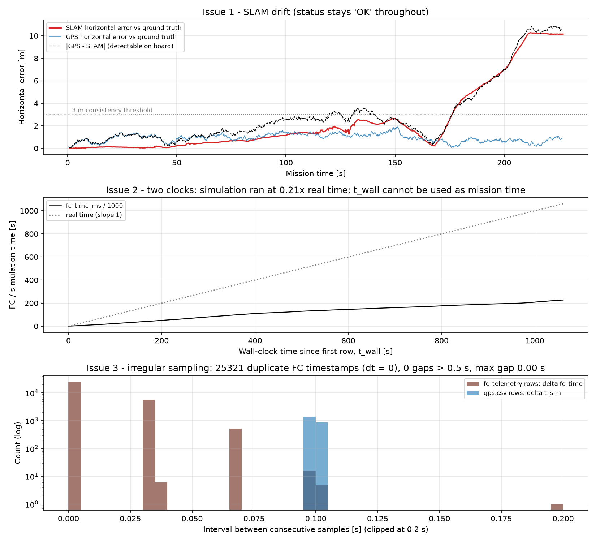

# Practical 2 – Telemetry, Localisation and Sensor Data

**Module:** Collaborative Unmanned Ground and Aerial Systems
**Data:** UAV autonomous-mission telemetry log (simulator feed over ROS 2 + MAVLink) and the UAV/UGV base-station feed from Practical 3

## 1. Aim

The aim is to:

- load recorded telemetry from the simulator;
- identify the position, orientation, timestamp and battery/status fields;
- plot the position data on a labelled map;
- identify and quantify data-quality issues in the recorded data.

## 2. Data Loaded

| Dataset | Source | Files | Rows |
|---|---|---|---|
| **A – UAV mission log (primary)** | Autonomous disaster-response mission, dynamic scene, 227 s. Recorded from the ROS 2 ↔ MAVLink bridge and autonomy nodes. | `logs/demo/windows_dynamic/telemetry/fc_telemetry.csv` | 31 539 |
| | | `telemetry/gps.csv` | 2 262 |
| | | `slam/slam_pose.csv` | 1 117 |
| | | `nav/nav_log.csv` | 10 519 |
| | | `sim/ground_truth.csv` *(evaluation only)* | 11 350 |
| **B – Multi-robot feed** | Practical 3 base-station message bus (UAV + UGV) | `practical_3/outputs/run_20261104_190102/messages.jsonl` | 993 messages |
| | | `ugv_estimate_vs_truth_eval_only.csv` | 827 |

**Tool:** Python 3.11 with NumPy and Matplotlib (`practical_2/analyse_telemetry.py`). The script loads every file, converts GPS latitude/longitude to local East/North metres, aligns all streams on mission time, and produces the figures and `telemetry_stats.json`.

Ground truth comes from the simulator and is never available to the vehicle. It is used here only to measure how good the recorded estimates are.

## 3. Field Explanation

### 3.1 `fc_telemetry.csv` – flight-controller telemetry (MAVLink, logged by the companion computer)

| Field | Category | Meaning | Units / values |
|---|---|---|---|
| `t_wall` | Timestamp | Companion-computer wall clock when the row was logged | Unix epoch [s] |
| `fc_time_ms` | Timestamp | FC time since boot (`time_boot_ms` of the MAVLink messages); equals simulation time | ms |
| `lat`, `lon` | Position | Global position from `GLOBAL_POSITION_INT` (FC estimate) | degrees WGS-84 |
| `alt` | Position | Altitude above mean sea level | m |
| `mode` | Status | FC flight mode decoded from `HEARTBEAT.custom_mode` | HOLD, OFFBOARD, LAND (FAILSAFE_HOLD if triggered) |
| `armed` | Status | Motors armed (`HEARTBEAT.base_mode` safety flag) | 0 / 1 |
| `system_status` | Status | MAVLink `MAV_STATE` | 3 = STANDBY, 4 = ACTIVE, 5 = CRITICAL |
| `failsafe_critical` | Status | FC reports a failsafe (`MAV_STATE_CRITICAL`) | 0 / 1 |
| `battery_v` | Battery | Pack voltage from `SYS_STATUS.voltage_battery` | V (6S: 19.2–25.2) |
| `battery_pct` | Battery | Remaining charge from `SYS_STATUS.battery_remaining` | % (integer) |
| `setpoints_sent` | Status | Cumulative `SET_POSITION_TARGET_LOCAL_NED` messages sent to the FC | count |

### 3.2 `gps.csv` – raw GNSS fix (`/uav/gps/fix`, from `GPS_RAW_INT`)

| Field | Category | Meaning | Units |
|---|---|---|---|
| `t_sim` | Timestamp | Message stamp in simulation (FC) time | s |
| `lat`, `lon`, `alt` | Position | Raw receiver fix (u-blox M10 class, 10 Hz) | deg, deg, m MSL |
| `status` | Status | `NavSatFix` status: 0 = fix, −1 = no fix | – |
| `cov_h_m2` | Quality | Horizontal position covariance reported by the receiver | m² (0.36 → σ = 0.6 m) |

### 3.3 `slam_pose.csv` – onboard localisation (`/uav/slam/pose`)

| Field | Category | Meaning | Units |
|---|---|---|---|
| `t` | Timestamp | Image timestamp of the processed RGB-D frame (simulation time) | s |
| `state` | Status | Tracking state: OK / LOST | – |
| `x`, `y`, `z` | Position | Body position in `slam_map`: x East, y North, z Up, origin at the take-off point | m |
| `qx`, `qy`, `qz`, `qw` | Orientation | Body attitude quaternion in `slam_map`. Yaw = atan2(2(qw·qz + qx·qy), 1 − 2(qy² + qz²)): 0° = East, 90° = North. | – |
| `inliers`, `features`, `keyframes` | Quality | ORB matches used, features detected, keyframes stored | count |
| `latency_ms` | Timestamp/quality | Processing delay of the frame | ms |

### 3.4 Other files

| File | Key fields | Use |
|---|---|---|
| `nav_log.csv` | `t`, `state` (ARM, TAKEOFF, SEARCH, INSPECT, RETURN, LANDING, DONE), `target`, `x y z yaw` (pose used by navigation), `vx_cmd vy_cmd vz_cmd yaw_rate_cmd`, `nearest_obs_m` | Mission state, waypoint target and commands at 10 Hz |
| `ground_truth.csv` *(evaluation only)* | `t`, `pn pe pd` (NED position), `roll pitch yaw`, `batt_v`, `soc`, `armed`, `mode`, `contacts` | Reference used here to measure SLAM and GPS error |
| `messages.jsonl` (dataset B), `STATUS` | `stamp` (sim time), `wall_time` (ISO, 1 s resolution), `agent_id`, `pose` [x, y, z] with `frame_id = mission_enu`, `yaw_deg`, `pose_local` / `pose_odom` (vehicle frame), `battery_pct`, `health`, `localisation`, `current_task`, `state`, `comm`; dropped messages carry `delivery = DROPPED_LINK_DOWN` | Base-station view of both robots at 1 Hz |

**Frames.** The FC works in NED (North-East-Down). SLAM, navigation and the plots use ENU (East-North-Up). GPS is converted to local metres about the first fix:

- East = Δlon · R · cos(lat₀)
- North = Δlat · R

where R = 6 378 137 m and the origin is lat₀ = 29.999971° N, lon₀ = 76.000000° E, altitude 249.9 m.

## 4. Plots and Maps

### Figure 1 – UAV position map (dataset A)

The figure overlays three position sources: the GPS fixes converted to East/North, the onboard SLAM estimate, and the evaluation-only ground truth. It also marks the take-off point, the actual landing point, the landing point SLAM believed, the true and detected survivors, and the fire hazard. The vehicle flew north to about 29 m and returned. GPS follows the true path to within about 1 m. SLAM agrees on the way out but bends away on the return, so the UAV landed **9 m west and 4 m north of home** while SLAM reported it was home.

### Figure 2 – Height, heading, battery and FC status vs mission time

| Quantity | What the plot shows |
|---|---|
| Height | Take-off at 2.5 s to a 2 m cruise height, landing at about 219 s. |
| Heading | SLAM yaw tracks the true yaw closely until about 125 s, then carries a growing offset of 20–35°. |
| Battery | Voltage falls from 24.93 V at rest, through 24.55 V under hover load, to 24.06 V just before landing, then recovers to 24.43 V once disarmed. Charge falls from 95 % to 86 %. |
| FC status | Mode goes HOLD → OFFBOARD (armed at 2.5 s) → LAND at 218 s, then disarms at 227 s. No failsafe occurred. |

### Figure 4 – Multi-robot feed (dataset B, Practical 3)

Left: UAV positions from STATUS messages (colour shows height) on its 3-lane survey, and the UGV's estimated path compared with its true path, inside the 40 × 30 m boundary. Right: the interval between consecutive STATUS messages from each robot, together with the UGV's position error.

## 5. Data-Quality Issues

### Figure 3 – Quantified data-quality issues (dataset A)

| # | Issue | Evidence | Effect |
|---|---|---|---|
| 1 | **Localisation drift (main issue)** | SLAM horizontal error vs ground truth: RMS **3.9 m**, final **10.1 m**. `state` = OK in all 1117 rows. Heading error up to about 35°. SLAM height stays at 2.0 m while the true height falls to 1.4 m, and reads 0.36 m after landing. | The pose looks valid but is wrong. Return-to-home landed 10 m from home, and anything geo-tagged from the SLAM pose late in the flight inherits the error. |
| 2 | **Two inconsistent clocks** | `t_wall` (Unix epoch) and `fc_time_ms` (simulation time) advance at different rates: 227 s of mission took 1061 s of wall time (0.21× real time). `gps.csv` and `slam_pose.csv` carry only simulation time. In dataset B, `wall_time` has 1 s resolution, so consecutive UGV messages share the same `wall_time` six times. | Plotting against `t_wall` stretches the mission about 5× and misaligns it with GPS and SLAM. All streams must be aligned on `fc_time_ms` / `t_sim`. |
| 3 | **Duplicated rows (oversampling)** | **25 321 of 31 539** `fc_telemetry.csv` rows (80 %) repeat the previous `fc_time_ms` (Δt = 0). The logger wrote at about 31 Hz of wall time while the FC produced new data more slowly. | Inflated row count and biased statistics such as averages and sample rates. Rows must be de-duplicated on `fc_time_ms` before use. |
| 4 | **Missing values / data gap** | Dataset B: no UGV STATUS for **8.0 s** (102–110 s), with 17 messages flagged `DROPPED_LINK_DOWN` during the radio outage. In dataset A, the first `command_centre/status.jsonl` record has `t_sim` and all pose fields equal to `null`, because it was written before the nodes came up. | The trajectory is interpolated across the gap, and the base station must treat the robot as unavailable (task HOLD). Null rows must be filtered out. |
| 5 | **Noisy GPS altitude** | GPS altitude wanders between −0.5 and 5.2 m relative to take-off while the vehicle holds 1.4–2.1 m (vertical σ = 1 m with a 30 s correlated error). | GPS altitude is unsuitable for height control near obstacles; the barometer, rangefinder or SLAM should be used for height. |
| 6 | **Low-resolution / wrapped fields** | `battery_pct` is an integer: only 10 levels (95 → 86) over the mission, each step about 24 s. Yaw wraps at ±180° (jump at 211 s in Fig. 2). | Battery trends need `battery_v`. Heading must be unwrapped before differencing or averaging. |

### Data-quality note

The most serious issue is **localisation drift that is not flagged**. With the fallback visual-odometry backend (no loop closure), SLAM error grew to 10.1 m, yet every pose was reported as `OK`. The drift is detectable on board: the independent GPS track disagrees with SLAM by more than 3 m from t = 120 s, about 50 s before the error became large. A GPS–SLAM consistency check, or fusing GPS into the estimate, would have caught it. Before any analysis, the log also has to be cleaned:

- align all streams on FC/simulation time rather than wall time;
- remove the 80 % duplicate telemetry rows;
- drop null records and mark the 8 s UGV gap as missing rather than interpolating silently;
- unwrap yaw;
- use `battery_v` instead of the quantised `battery_pct`.

The UGV in dataset B shows the same kind of effect on a smaller scale: its wheel-odometry estimate reached a 0.9 m error over 30 m driven.

## 6. Summary Statistics (from `telemetry_stats.json`)

| Metric | Value |
|---|---|
| Mission duration (simulation / wall) | 227 s / 1061 s (0.21× real time) |
| GPS horizontal error vs truth | RMS 0.98 m, max 1.91 m |
| SLAM horizontal error vs truth | RMS 3.93 m, max 10.27 m, final 10.14 m |
| Landing point (East, North) – truth / GPS / SLAM | (−8.96, 3.85) / (−8.95, 4.64) / (0.34, −0.21) m |
| Battery | 24.93 V → 24.43 V, 95 % → 86 % |
| Duplicate FC telemetry rows | 25 321 (80 %) |
| UGV STATUS gap / dropped messages (dataset B) | 8.0 s / 17 |
| UGV odometry error (dataset B) | max 0.90 m |

**Reproduce:** `robot_vision\robot_vision\venv\Scripts\python.exe practical_2\analyse_telemetry.py`
